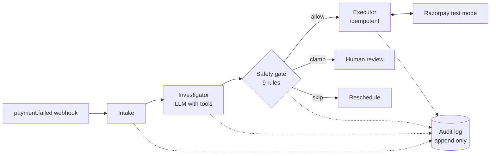

# Recovery OPS

[](https://github.com/Mithurn/Recovery-OPS/actions/workflows/ci.yml)

A multi-agent workspace that recovers failed Razorpay payments. Five agents investigate why each payment failed, propose one recovery action, and pass it through a deterministic safety gate the model cannot override. Everything is streamed live and written to an append-only audit log.


**Live demo:** https://recovery-opsagents.vercel.app

Open `/demo` for a recorded replay with no sign-in; it is always up. `/app` needs the AWS backend running, which is started on demand (see [deploy/aws/COMMANDS.md](deploy/aws/COMMANDS.md)). Sign up there, paste your own Razorpay **test** keys, and the same agents work your account.

## How a case moves



- **Investigator** calls tools for customer history, live bank downtime, similar resolved cases and the merchant playbook, then names a root cause and proposes an action.
- **Safety gate** applies nine rules in code: risk hold, hard decline, attempt cap, exposure cap, confidence floor, cooldowns and an RBI aligned contact window. The model only proposes; what the gate decides is what runs.
- **Executor** makes at most one Razorpay call per attempt, keyed by an idempotency key.
- **Audit log** is insert only by database `GRANT`. The UI can prove it by attempting an `UPDATE` as the app role.

## Product

| Page | What it does |
| --- | --- |
| Agent workspace | The live floor, a command bar (`/simulate`, `/retry`, `/open`, `/stop`) and a run log of every tool call |
| Cases | Filterable table by status, reason, method, bank and derived priority |
| Needs you | Cases the gate escalated, with approve, payment link, nudge or write off |
| Settings | Razorpay test keys, webhook URL and account |

Accounts sign in with an emailed code. Razorpay secrets are encrypted at rest with AES-256-GCM and never returned to the browser. Live keys are rejected.

## Run locally

```bash
cp .env.example .env          # set VAULT_KEY, SESSION_SECRET and a model key
docker compose up -d          # Postgres on 5434, Redis on 6381
npm ci
npm run dev                   # API on :3000, web on :5173
```

Without `RESEND_API_KEY`, sign-in codes print to the API console.

## Deploy

```bash
cp .env.example .env          # NODE_ENV=production, PUBLIC_URL, RESEND_API_KEY, secrets
export ADMIN_DB_PASSWORD=... APP_DB_PASSWORD=...
docker compose -f compose.prod.yml up -d --build
```

One container serves the API and the built web app. Point Razorpay webhooks at the URL shown in Settings.

## Results

Reproduce with `npm run bench` (no services, no keys). It generates a seeded synthetic corpus of failed payments with known ground truth, runs three arms through the real `safetyGate`, and prints this table:

| Arm | Recovery rate (mean) | Std dev | Range over seeds | Root-cause accuracy | Gate intervened |
| --- | --- | --- | --- | --- | --- |
| Fixed retry schedule | 45.7% | 2.8% | 43.3% to 50.0% | n/a | 28.7% |
| Hand-tuned rules table | 53.7% | 3.6% | 51.7% to 60.0% | 100.0% | 13.0% |
| Agent behind gate (SCRIPTED STAND-IN, not an LLM) | 55.3% | 4.8% | 48.3% to 61.7% | 80.3% | 34.3% |

Five seeds, 60 cases each.

**The agent row is not a language model.** The committed run replays `bench/transcripts/`, which a deterministic scripted policy (`bench/standin.ts`) generated. It reads the same signals the agent's tools expose, misdiagnoses a fixed share of cases on purpose, and its accuracy is a property of that script. What the row does measure is the pipeline around the model: the corpus, the simulator and the gate clamping unsafe proposals. It says nothing about any LLM.

The earlier figures (agent 56.0%, rules table 59.3%, fixed schedule 35.7%) came from an evaluation whose harness is not in this repository. They cannot be reproduced and are superseded by the table above.

```bash
npm run bench                              # table above, 5 seeds x 60 cases
npm run bench -- --seeds 5 --cases 60      # explicit
npm run bench:record                       # regenerate the scripted transcripts
OPENROUTER_API_KEY=... npm run bench -- --live --seeds 1 --cases 20   # real agent, records bench/transcripts/live-seed-N.json
```

`--live` runs the real recovery agent with its tools backed by each synthetic case (set `AGENT_MODEL` or pass `--model`; with only a Google key use `--model google/<id>`). The table then labels the arm with the model id. Method and limits are in [docs/BENCHMARK.md](docs/BENCHMARK.md).

## Security model

- Email code sign-in, codes and session tokens stored hashed, code requests rate limited per IP.
- Razorpay secrets encrypted with AES-256-GCM, never returned to the browser, test keys only.
- Webhooks verified by HMAC signature and deduplicated by event id.
- Audit log is insert only for the app role, enforced by the database.

## Architecture and decisions

- [docs/ARCHITECTURE.md](docs/ARCHITECTURE.md): flow, layers, data model, guarantees
- [docs/DECISIONS.md](docs/DECISIONS.md): design tradeoffs

## Limitations and roadmap

- Razorpay test mode only; no live money path has been exercised.
- Single container, no high availability. The demo backend is stopped when idle.
- Tenant isolation is in application queries, not row-level security.
- The audit log has no hash chain, so it does not protect against a database admin.
- The default model is a free OpenRouter model, so diagnosis quality varies.
- Auth rate limiting is in memory and per process.
- The benchmark is synthetic, scores one decision per case, and its committed agent row is a scripted stand-in. A recorded live-model run is not committed. See [docs/BENCHMARK.md](docs/BENCHMARK.md).

## Tests

```bash
npm run test:unit     # no services needed
npm test              # adds Postgres and Redis integration tests
npm run bench         # reproducible recovery benchmark
```

## Credits

The pixel floor engine is adapted from [Munder Difflin](https://github.com/chaitanyagiri/munder-difflin) (MIT), and the loader and trace patterns from [beautifului.dev](https://www.beautifului.dev) (MIT). All art is drawn in code. See [NOTICE](NOTICE).

MIT licensed.
