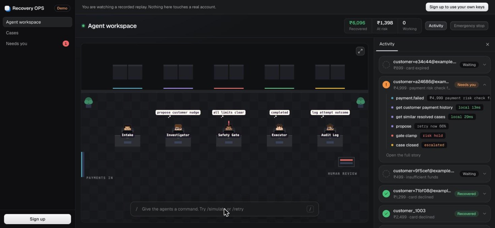
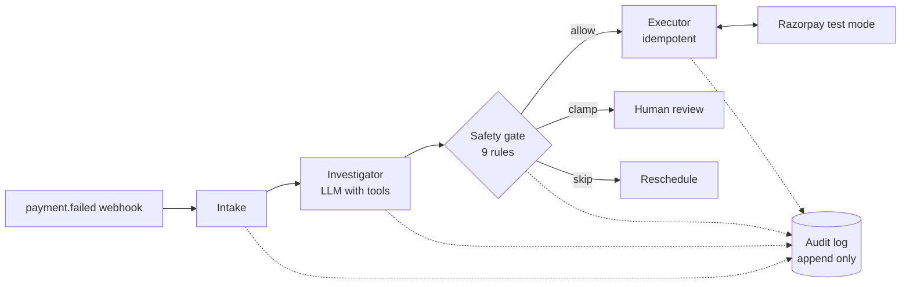

# Recovery OPS

A multi-agent workspace that recovers failed Razorpay payments. Five agents investigate why each payment failed, propose one recovery action, and pass it through a deterministic safety gate the model cannot override. Everything is streamed live and written to an append-only audit log.



**Live demo:** https://recovery-opsagents.vercel.app

Open `/demo` for a recorded replay with no sign-in; it is always up. `/app` needs the AWS backend running, which is started on demand (see [deploy/aws/COMMANDS.md](deploy/aws/COMMANDS.md)). Sign up there, paste your own Razorpay **test** keys, and the same agents work your account.

## How a case moves



- **Investigator** calls tools for customer history, live bank downtime, similar resolved cases and the merchant playbook, then names a root cause and proposes an action.
- **Safety gate** applies nine rules in code: risk hold, hard decline, attempt cap, exposure cap, confidence floor, cooldowns and an RBI aligned contact window. The model only proposes; what the gate decides is what runs.
- **Executor** makes at most one Razorpay call per attempt, keyed by an idempotency key.
- **Audit log** is insert only by database `GRANT`. The UI can prove it by attempting an `UPDATE` as the app role.

## Product

| Page | What it does |
| --- | --- |
| Agent workspace | The live floor, a command bar (`/simulate`, `/retry`, `/open`, `/stop`) and a run log of every tool call |
| Cases | Filterable table by status, reason, method, bank and derived priority |
| Needs you | Cases the gate escalated, with approve, payment link, nudge or write off |
| Settings | Razorpay test keys, webhook URL and account |

Accounts sign in with an emailed code. Razorpay secrets are encrypted at rest with AES-256-GCM and never returned to the browser. Live keys are rejected.

## Run locally

```bash
cp .env.example .env          # set VAULT_KEY, SESSION_SECRET and a model key
docker compose up -d          # Postgres on 5434, Redis on 6381
npm ci
npm run dev                   # API on :3000, web on :5173
```

Without `RESEND_API_KEY`, sign-in codes print to the API console.

## Deploy

```bash
cp .env.example .env          # NODE_ENV=production, PUBLIC_URL, RESEND_API_KEY, secrets
export ADMIN_DB_PASSWORD=... APP_DB_PASSWORD=...
docker compose -f compose.prod.yml up -d --build
```

One container serves the API and the built web app. Point Razorpay webhooks at the URL shown in Settings.

## Results

Historical figures from an earlier evaluation: replayed from recorded model transcripts, five seeds of a 60 case synthetic corpus with known ground truth. The corpus generator, baselines, transcripts and replay harness are not in this repository, so these numbers cannot be reproduced from it.

| Strategy | Recovery rate (mean) |
| --- | --- |
| Agent behind the gate | 56.0% |
| Hand tuned rules table | 59.3% |
| Fixed retry schedule | 35.7% |

The agent recovered far more than a fixed schedule and landed within about three points of a rules table without beating it. It named the root cause correctly 73% of the time and leaves an auditable reasoning trail.

## Security model

- Email code sign-in, codes and session tokens stored hashed, code requests rate limited per IP.
- Razorpay secrets encrypted with AES-256-GCM, never returned to the browser, test keys only.
- Webhooks verified by HMAC signature and deduplicated by event id.
- Audit log is insert only for the app role, enforced by the database.

## Architecture and decisions

- [docs/ARCHITECTURE.md](docs/ARCHITECTURE.md): flow, layers, data model, guarantees
- [docs/DECISIONS.md](docs/DECISIONS.md): design tradeoffs

## Limitations and roadmap

- Razorpay test mode only; no live money path has been exercised.
- Single container, no high availability. The demo backend is stopped when idle.
- Tenant isolation is in application queries, not row-level security.
- The audit log has no hash chain, so it does not protect against a database admin.
- The default model is a free OpenRouter model, so diagnosis quality varies.
- Auth rate limiting is in memory and per process.
- Evaluation harness is not published. A reproducible one needs the corpus generator with seeds, the two baselines, recorded transcripts with the model id, and an `npm run bench` that prints the table.

## Tests

```bash
npm run test:unit     # no services needed
npm test              # adds Postgres and Redis integration tests
```

## Credits

The pixel floor engine is adapted from [Munder Difflin](https://github.com/chaitanyagiri/munder-difflin) (MIT), and the loader and trace patterns from [beautifului.dev](https://www.beautifului.dev) (MIT). All art is drawn in code. See [NOTICE](NOTICE).

MIT licensed.
