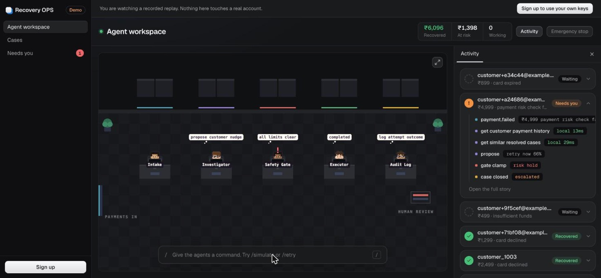
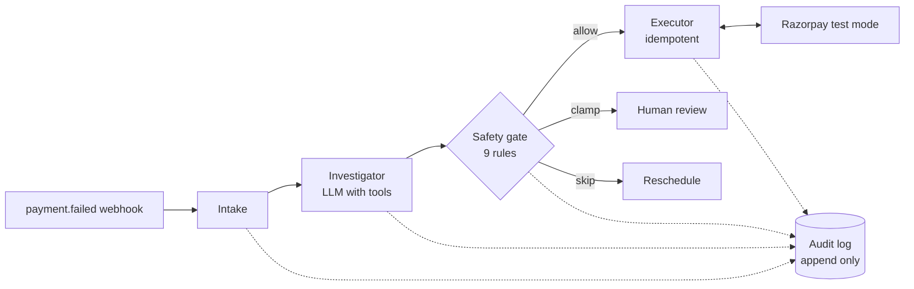

# Recovery OPS

A multi-agent workspace that recovers failed Razorpay payments. Five agents investigate why each payment failed, propose one recovery action, and pass it through a deterministic safety gate the model cannot override. Everything is streamed live and written to an append-only audit log.



Open `/demo` for a recorded replay with no sign-in. Sign up at `/app`, paste your own Razorpay **test** keys, and the same agents work your account.

## How a case moves



- **Investigator** calls tools for customer history, live bank downtime, similar resolved cases and the merchant playbook, then names a root cause and proposes an action.
- **Safety gate** applies nine rules in code: risk hold, hard decline, attempt cap, exposure cap, confidence floor, cooldowns and an RBI aligned contact window. The model only proposes; what the gate decides is what runs.
- **Executor** makes at most one Razorpay call per attempt, keyed by an idempotency key.
- **Audit log** is insert only by database `GRANT`. The UI can prove it by attempting an `UPDATE` as the app role.

## Product

| Page | What it does |
| --- | --- |
| Agent workspace | The live floor, a command bar (`/simulate`, `/retry`, `/open`, `/stop`) and a run log of every tool call |
| Cases | Filterable table by status, reason, method, bank and derived priority |
| Needs you | Cases the gate escalated, with approve, payment link, nudge or write off |
| Settings | Razorpay test keys, webhook URL and account |

Accounts sign in with an emailed code. Razorpay secrets are encrypted at rest with AES-256-GCM and never returned to the browser. Live keys are rejected.

## Run locally

```bash
cp .env.example .env          # set VAULT_KEY, SESSION_SECRET and a model key
docker compose up -d          # Postgres on 5434, Redis on 6381
npm ci
npm run dev                   # API on :3000, web on :5173
```

Without `RESEND_API_KEY`, sign-in codes print to the API console.

## Deploy

```bash
cp .env.example .env          # NODE_ENV=production, PUBLIC_URL, RESEND_API_KEY, secrets
export ADMIN_DB_PASSWORD=... APP_DB_PASSWORD=...
docker compose -f compose.prod.yml up -d --build
```

One container serves the API and the built web app. Point Razorpay webhooks at the URL shown in Settings.

## Results

Replayed from recorded model transcripts, five seeds of a 60 case synthetic corpus with known ground truth.

| Strategy | Recovery rate (mean) |
| --- | --- |
| Agent behind the gate | 56.0% |
| Hand tuned rules table | 59.3% |
| Fixed retry schedule | 35.7% |

The agent recovers far more than a fixed schedule and lands within about three points of a rules table without beating it. It also names the root cause correctly 73% of the time and leaves an auditable reasoning trail.

## Tests

```bash
npm run test:unit     # no services needed
npm test              # adds Postgres and Redis integration tests
npm run test:coverage # same as npm test, with a coverage report
npm run lint          # ESLint
npm run typecheck     # server and tests; web: npx tsc --noEmit -p web/tsconfig.json
```

Integration tests skip themselves unless `DATABASE_URL`, `ADMIN_DATABASE_URL` and `REDIS_URL` are set (`docker compose up -d` provides both services; load `db/schema.sql` first if you use your own Postgres). The Razorpay client tests also need test keys.

## Contributing

1. Branch from `main`.
2. Keep to the dependency rule in `tests/architecture.test.ts` (see [docs/ARCHITECTURE.md](docs/ARCHITECTURE.md)).
3. Add tests with your change, then make sure `npm run lint`, `npm run typecheck`, `npm run web:build` and `npm test` pass. CI runs the same checks.
4. Open a pull request.

## Credits

The pixel floor engine is adapted from [Munder Difflin](https://github.com/chaitanyagiri/munder-difflin) (MIT), and the loader and trace patterns from [beautifului.dev](https://www.beautifului.dev) (MIT). All art is drawn in code. See [NOTICE](NOTICE).

MIT licensed.
