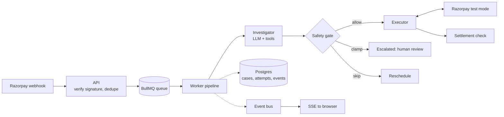

# Architecture

## Flow



1. The webhook route verifies the HMAC signature against the tenant's webhook secret, records the event id in `razorpay_webhooks` (a duplicate delivery inserts nothing) and creates a case.
2. A BullMQ job (`attempts: 4`, exponential backoff) runs the pipeline for the case.
3. The investigator calls tools (customer history, bank downtime, similar resolved cases, merchant playbook) and returns a root cause, a confidence and a proposed `RecoveryAction`.
4. `safetyGate` returns allow, clamp (replace with `ESCALATE`) or skip (reschedule).
5. The executor records a PENDING attempt, makes at most one Razorpay call, then settles from the resolved outcome. A gateway outage parks the attempt as `AWAITING_RECONCILIATION`.
6. A reconcile sweep (every 5 minutes) re-enqueues cases that have unsettled attempts.

## Layers

```
api / worker / tenants  ->  agent · safety · execution · persistence  ->  domain
```

`domain/` holds zod schemas, types and ports. `safety/` is pure policy. Only `persistence/` imports `pg`. `tests/architecture.test.ts` fails the build on a violation.

## Data model

- `recovery_cases`: one row per failed payment, with a `lane` (INCOMING, DIAGNOSING, DECIDING, ATTEMPTING, RECOVERED, RETRY_SCHEDULED, ESCALATED, WRITTEN_OFF, STOPPED). `run_id IS NULL` marks a live case.
- `recovery_attempts`: one row per action taken, with a UNIQUE `idempotency_key`.
- `recovery_events`: the audit log, one row per step, ordered by `id`.
- `razorpay_webhooks`: raw deliveries, primary key `event_id`.
- `recovery_runs`: groups cases for evaluation arms (`fixed`, `agent`, `rules`).
- `users`, `otp_codes`, `sessions`, `tenant_credentials`: auth and per-user Razorpay keys.

## Guarantees

- **Audit log.** `recovery_events` and `razorpay_webhooks` grant the app role only SELECT and INSERT. The database refuses UPDATE and DELETE; `GET /cases/:id/audit/verify` and `npm run verify-audit` attempt a no-op UPDATE and report the refusal. This protects against the application, not against a database admin; there is no hash chain.
- **Idempotency.** Each attempt derives a key from case id and attempt number. The unique index means a retried job reuses the attempt, and when settling, the executor looks up an existing Razorpay order or payment link by that key before creating one.
- **Stop and brake.** `/stop` and `/cases/:id/stop` write to a stop store (Redis-backed per tenant runtime; an in-memory store is used in unit tests) that the pipeline checks before acting. `/resume` clears the global stop.
- **Tenant isolation.** Each user has their own Razorpay credentials and webhook token (`/webhooks/razorpay/:token`). Case, queue, activity and metrics reads are filtered by the signed-in user. Isolation is enforced in repository queries, not by Postgres row-level security.
- **Live updates.** `GET /stream` and `GET /cases/:id/stream` are Server-Sent Events. The handler subscribes to the event bus before reading the snapshot, so an event landing in between is not lost, and sends a keep-alive ping every 15 seconds.

## Safety gate

Nine rules, in code, in `src/safety/safety-gate.ts`. Defaults: 4 attempts, 5,000 INR exposure cap, 0.6 confidence floor, 6 hour attempt cooldown, 24 hour contact cooldown, contact window 08:00 to 19:00 IST. Rules that clamp send the case to a human; rules that skip reschedule it.

## Security model

- Sign-in with a 6 digit emailed code stored hashed; session tokens stored as SHA-256 hashes.
- Razorpay key and webhook secrets are encrypted with AES-256-GCM using `VAULT_KEY`.
- Webhook signatures are checked with HMAC-SHA256 and a timing-safe compare.
- Code requests are rate limited per IP (fixed window, in memory, per process).
- Only Razorpay test keys are accepted.
